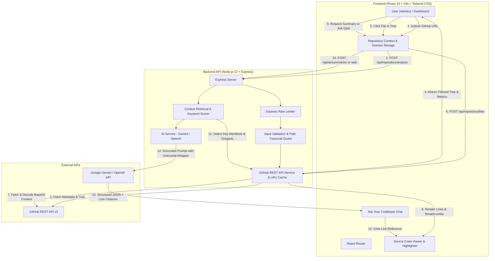

# DevLens AI — AI-Powered GitHub Repository Analyzer

[](LICENSE)
[](https://nodejs.org)
[](https://react.dev)
[](https://devlens-ai-rust.vercel.app)

> **Understand Any Codebase. In Minutes.**  
> Explore unfamiliar GitHub repositories, understand project architecture, inspect source files, and get source-grounded explanations with AI.
>
> 🌐 **Live Production App**: **[https://devlens-ai-rust.vercel.app](https://devlens-ai-rust.vercel.app)**  
> 📦 **GitHub Repository**: **[https://github.com/daminsahu697-debug/devlens-ai](https://github.com/daminsahu697-debug/devlens-ai)**

---

## Table of Contents
1. [Project Overview](#project-overview)
2. [Problem Statement](#problem-statement)
3. [Key Features](#key-features)
4. [Architecture & System Flow](#architecture--system-flow)
5. [Tech Stack](#tech-stack)
6. [Folder Structure](#folder-structure)
7. [Installation & Setup](#installation--setup)
8. [Environment Configuration](#environment-configuration)
9. [Running Locally](#running-locally)
10. [API Endpoint Documentation](#api-endpoint-documentation)
11. [Security Considerations](#security-considerations)
12. [Testing & Verification](#testing--verification)
13. [Known Limitations & Future Improvements](#known-limitations--future-improvements)

---

## Project Overview
**DevLens AI** is a production-grade full-stack developer tool designed to bridge the comprehension gap when engineers explore unfamiliar open-source projects or legacy codebases. Instead of spending hours reading through disjointed files, developers can analyze any public GitHub repository to instantly retrieve official metadata, explore categorized file trees, view source code with line numbers, generate architectural summaries, and ask source-grounded questions with line-level citations.

---

## Problem Statement
When software engineers join a new team or evaluate an open-source library, they face significant friction:
- **High cognitive load**: Deciphering repository structure, finding the actual application entry point, and identifying critical dependencies takes hours.
- **Unreliable LLM hallucinations**: Asking standard chatbots about codebases frequently produces fabricated file paths, phantom dependencies, and inaccurate execution flows.
- **Security vulnerabilities**: Naively sending repository contents to an LLM exposes systems to prompt injection attacks embedded in malicious README files.
- **API rate limit barriers**: Unauthenticated GitHub API calls are strictly capped at 60 requests per hour.

**DevLens AI** solves these challenges by combining GitHub REST API tree traversal, in-memory caching, strict prompt injection isolation (`<untrusted_repository_content>`), and source-grounded heuristic retrieval.

---

## Key Features

- **Real-Time GitHub Analysis**: Fetches repository metadata, stars, forks, open issues, licenses, and full Git Trees from GitHub REST API.
- **Calculated Metric Differentiation**: Explicitly distinguishes authentic GitHub API metadata from metrics calculated by the DevLens analysis engine (discovered files, source files, documentation files, manifests).
- **Interactive File Explorer**: Filter repository files by category (`All`, `Source`, `Docs`, `Config`) or live search query, preventing DOM lag on large repositories.
- **In-Browser Source Code Viewer**: Inspect retrieved files with line numbering, syntax formatting, line count, file size, copy snippet action, and direct GitHub links.
- **AI Architectural Intelligence**: Synthesizes project purpose, detected libraries, high-level architecture, entry points, and running instructions using verified files (README, package manifests, and main source files).
- **Ask Your Codebase (Source-Grounded Q&A)**: Ask natural language questions; the backend performs keyword and path-relevance matching over the repository files and prompts the LLM to cite specific files and lines.
- **Prompt Injection Defense**: All repository content is enclosed in untrusted tags and guarded with system-level directives instructing the model never to execute code or follow embedded instructions.
- **Flexible Credential Handling**: Zero hardcoded secrets. Supports backend `.env` variables or temporary in-session browser keys stored strictly in `sessionStorage`.

---

## Architecture & System Flow



---

## Tech Stack

| Layer | Technology | Purpose |
| :--- | :--- | :--- |
| **Frontend Framework** | React 19, Vite 8 | Fast SPA rendering and developer experience |
| **Styling** | Tailwind CSS 3.4, Vanilla CSS | Modern dark theme, glassmorphism, responsive cards |
| **Routing** | React Router 7 | Client-side routing (`/`, `/analyzer`, `/ask`, `/history`, `/settings`) |
| **Icons** | Lucide React | Developer-focused icon set |
| **Charts** | Recharts | File extension distribution bar charts |
| **Backend Runtime** | Node.js 22 (ES Modules) | High-performance asynchronous runtime |
| **Web Server** | Express 4.21 | Modular REST API server |
| **Security** | Helmet, CORS, Rate Limit | HTTP header security, restricted origins, DoS protection |
| **LLM Provider** | Google Gemini (`@google/generative-ai`) | High-speed architectural summarization and source Q&A |
| **Testing** | Node.js Test Runner (`node:test`, `node:assert`) | Zero-dependency unit and integration testing |

---

## Folder Structure

```
devlens-ai/
├── package.json               # Root scripts for running frontend and backend
├── README.md                  # Comprehensive technical documentation
├── .gitignore                 # Root gitignore
│
├── backend/
│   ├── package.json           # Backend dependencies and scripts
│   ├── .env.example           # Example environment variables template
│   ├── .env                   # Local environment configuration
│   ├── src/
│   │   ├── server.js          # Main Express server and middleware setup
│   │   ├── routes/
│   │   │   ├── repositoryRoutes.js  # /analyze and /files endpoints
│   │   │   ├── aiRoutes.js          # /summarize and /ask endpoints
│   │   │   └── configRoutes.js      # /status and /health endpoints
│   │   ├── services/
│   │   │   ├── githubService.js     # GitHub API, tree traversal, rate limits, cache
│   │   │   ├── retrievalService.js  # Heuristic keyword search and excerpt extraction
│   │   │   └── aiService.js         # Prompt construction, injection defense, LLM API
│   │   ├── middleware/
│   │   │   ├── rateLimiter.js       # IP rate limiting for general & AI routes
│   │   │   └── errorHandler.js      # Centralized error handler and 404 handler
│   │   └── utils/
│   │       └── validation.js        # URL, path traversal, and question sanitization
│   └── tests/
│       ├── validation_and_api.test.js # Unit test suite
│       └── integration.test.js        # Express HTTP endpoint integration tests
│
└── frontend/
    ├── package.json           # Frontend dependencies and Vite scripts
    ├── vite.config.js         # Vite configuration with backend API proxy
    ├── tailwind.config.js     # Tailwind CSS theme configuration
    ├── postcss.config.js      # PostCSS configuration
    ├── index.html             # HTML entry point with SEO metadata
    └── src/
        ├── main.jsx           # React DOM mounting
        ├── App.jsx            # Layout, sidebar, topbar, and router routes
        ├── index.css          # Design system tokens, fonts, and scrollbars
        ├── context/
        │   └── RepositoryContext.jsx # Global state management & session storage
        ├── services/
        │   └── api.js         # Backend HTTP client
        ├── components/
        │   ├── Sidebar.jsx            # Collapsible navigation sidebar
        │   ├── Topbar.jsx             # Top bar with status pills and title
        │   ├── RepositoryInput.jsx    # URL input with instant samples
        │   ├── RepositoryOverview.jsx # Metadata and calculated stats cards
        │   ├── MetricCard.jsx         # Metric display card
        │   ├── FileExplorer.jsx       # Interactive file tree with filtering
        │   ├── SourceCodeViewer.jsx   # Line-numbered code viewer with copy
        │   ├── SummaryPanel.jsx       # AI architecture summary cards
        │   ├── QuestionAnswerPanel.jsx# Grounded Q&A chat with file links
        │   ├── LanguageChart.jsx      # Recharts file distribution chart
        │   ├── LoadingSkeleton.jsx    # Shimmer loading animations
        │   ├── ErrorMessage.jsx       # Actionable error alert banner
        │   ├── EmptyState.jsx         # Landing hero and sample repo links
        │   └── GithubIcon.jsx         # Reusable SVG icon component
        └── pages/
            ├── Dashboard.jsx          # Overview and quick-jump actions
            ├── AnalyzerPage.jsx       # File explorer and code viewer workspace
            ├── AskCodebasePage.jsx    # Full-featured codebase Q&A chat
            ├── HistoryPage.jsx        # Analysis history with 1-click re-analysis
            └── SettingsPage.jsx       # Credential setup and status monitoring
```

---

## Installation & Setup

### Prerequisites
- **Node.js** v20.0.0 or higher
- **npm** v10.0.0 or higher

### 1. Clone or Open Project
```bash
cd devlens-ai
```

### 2. Install Dependencies
```bash
# Install backend dependencies
cd backend
npm install

# Install frontend dependencies
cd ../frontend
npm install

# Return to root
cd ..
```

---

## Environment Configuration

Create a `.env` file inside `backend/.env` (a template is provided in `backend/.env.example`):

```bash
cp backend/.env.example backend/.env
```

Edit `backend/.env`:
```ini
PORT=5000
FRONTEND_ORIGIN=http://localhost:5173

# Optional: GitHub Personal Access Token (Increases rate limit from 60 to 5,000 req/hr)
# Generate free token at: https://github.com/settings/tokens (no special scopes needed)
GITHUB_TOKEN=

# AI LLM Provider Configuration
# Supported providers: "gemini" (recommended) or "openai"
LLM_PROVIDER=gemini
LLM_API_KEY=your_gemini_api_key_here
LLM_MODEL=gemini-1.5-flash
```

> **How to get a Free Gemini API Key**:  
> 1. Visit [Google AI Studio](https://aistudio.google.com/app/apikey).  
> 2. Click **Create API Key**.  
> 3. Copy the key into `backend/.env` or paste it directly in the **Settings** view in the DevLens AI frontend interface.

---

## Running Locally

### Starting Backend (Port 5000)
```bash
cd backend
npm run dev
```

### Starting Frontend (Port 5173)
```bash
cd frontend
npm run dev
```

Open your browser to: **[http://localhost:5173](http://localhost:5173)**.

---

## API Endpoint Documentation

All endpoints return structured JSON adhering to the convention:
- **Success**: `{ "success": true, "data": { ... } }`
- **Failure**: `{ "success": false, "error": { "message": "...", "code": "..." } }`

### 1. Analyze Repository
- **Endpoint**: `POST /api/repository/analyze`
- **Rate Limit**: 30 requests / 10 minutes
- **Request Body**:
  ```json
  {
    "repositoryUrl": "https://github.com/expressjs/express"
  }
  ```
- **Response**:
  ```json
  {
    "success": true,
    "data": {
      "metadata": {
        "id": 237159,
        "name": "express",
        "fullName": "expressjs/express",
        "stars": 69576,
        "forks": 12100,
        "language": "JavaScript",
        "defaultBranch": "master",
        "description": "Fast, unopinionated, minimalist web framework"
      },
      "stats": {
        "totalDiscovered": 284,
        "returnedFiles": 284,
        "sourceFilesCount": 193,
        "docsFilesCount": 35,
        "configFilesCount": 14,
        "isTruncated": false
      },
      "languageBreakdown": [
        { "name": "JS", "count": 142, "extension": "js" },
        { "name": "EJS", "count": 21, "extension": "ejs" }
      ]
    }
  }
  ```

### 2. Retrieve Source File
- **Endpoint**: `POST /api/repository/files`
- **Request Body**:
  ```json
  {
    "owner": "expressjs",
    "repo": "express",
    "path": "package.json",
    "branch": "master"
  }
  ```
- **Response**:
  ```json
  {
    "success": true,
    "data": {
      "path": "package.json",
      "name": "package.json",
      "extension": "json",
      "sizeBytes": 2731,
      "lineCount": 100,
      "content": "{\n  \"name\": \"express\",\n ... \n}"
    }
  }
  ```

### 3. AI Architecture Summary
- **Endpoint**: `POST /api/ai/summarize`
- **Rate Limit**: 30 requests / 10 minutes
- **Request Body**:
  ```json
  {
    "owner": "expressjs",
    "repo": "express"
  }
  ```
- **Response**:
  ```json
  {
    "success": true,
    "data": {
      "summary": {
        "projectPurpose": "Fast, unopinionated web framework for Node.js.",
        "mainTechnologies": ["Node.js", "JavaScript", "accepts", "cookie"],
        "importantFiles": [
          { "path": "lib/express.js", "responsibility": "Main library factory" },
          { "path": "lib/application.js", "responsibility": "Express Application prototype" }
        ],
        "architecture": "Modular middleware-pipeline library",
        "executionFlow": "Entry point in lib/express.js exposes createApplication()",
        "setupInstructions": "npm install express",
        "limitations": "Plugin and community middleware logic not analyzed in core repo.",
        "confidenceNotes": "Verified against package.json and lib/ directory files."
      }
    }
  }
  ```

### 4. Ask Your Codebase
- **Endpoint**: `POST /api/ai/ask`
- **Rate Limit**: 30 requests / 10 minutes
- **Request Body**:
  ```json
  {
    "owner": "expressjs",
    "repo": "express",
    "question": "Where does the application start?"
  }
  ```
- **Response**:
  ```json
  {
    "success": true,
    "data": {
      "question": "Where does the application start?",
      "answer": "The application entry point is located in lib/express.js which exports createApplication()...",
      "confidence": "high",
      "hasSufficientEvidence": true,
      "references": [
        {
          "file": "lib/express.js",
          "lineStart": 1,
          "lineEnd": 30,
          "reason": "Exposes createApplication() initialization function"
        }
      ]
    }
  }
  ```

### 5. System Status
- **Endpoint**: `GET /api/config/status`
- **Response**:
  ```json
  {
    "success": true,
    "data": {
      "llmConfigured": true,
      "llmProvider": "gemini",
      "llmModel": "gemini-1.5-flash",
      "githubTokenConfigured": false,
      "rateLimit": { "remaining": 58, "limit": 60 }
    }
  }
  ```

---

## Security Considerations

1. **SSRF & Malformed URL Protection**: The backend strictly validates that incoming URLs target `github.com` and match standard repository naming conventions (`^[a-zA-Z0-9_.-]+$`). Arbitrary external URLs are rejected.
2. **Directory Traversal Defense**: File paths requested by clients are validated against path traversal sequences (`..`), null bytes (`\0`), and absolute path prefixes.
3. **Prompt Injection Defense**: All untrusted user code, documentation, and metadata passed to the LLM are enclosed within `<untrusted_repository_content>` tags. Explicit system instructions mandate that the model never interpret text inside those tags as instructions or directives.
4. **Code Execution Guarantee**: Repository code is strictly treated as passive text data. The system **never executes** scripts, builds, or commands from analyzed repositories.
5. **No Credential Leaks**: API keys are never returned in responses, logged to stdout, or committed to version control. In-session keys are stored only in `sessionStorage` (which clears when the browser tab is closed).
6. **Rate Limiting**: `express-rate-limit` prevents Denial of Service (DoS) attacks on expensive AI and GitHub endpoints.
7. **Safe Code Rendering**: Code content is rendered safely using standard React text nodes without raw `dangerouslySetInnerHTML`.

---

## Testing & Verification

The application includes an automated test suite verifying input validation, security controls, and endpoint behavior.

To run the test suite:
```bash
cd backend
npm test
```

### Test Results Summary:
- **1. Repository URL Validation & Security**: 6/6 passed (Valid URLs, URL without protocol, `.git` stripping, SSRF rejection, invalid character rejection, traversal rejection).
- **2. File Path Validation & Traversal Defense**: 4/4 passed (Relative paths accepted, `..` traversal rejected, absolute paths rejected, binary files rejected).
- **3. Question Validation for Codebase Q&A**: 3/3 passed (Valid question accepted, empty question rejected, max length enforced).
- **4. File Extension Extraction**: 1/1 passed.
- **5. Integration HTTP Tests**: 7/7 passed (`GET /`, `GET /status`, invalid URL rejection `400`, path traversal rejection `400`, binary rejection `400`, missing AI key rejection `400`, empty question rejection `400`).
- **Total**: 21 passed, 0 failed.

---

## Known Limitations & Future Improvements

### Limitations & AI Disclaimer
> [!IMPORTANT]
> **AI Accuracy Disclaimer**: All summaries and answers produced by DevLens AI are synthesized strictly from retrieved repository excerpts (READMEs, manifests, entry point files, and keyword-matched code lines). The model's knowledge is bounded by the context retrieved; it does not read every single line of a multi-million-line repository. Inferences are distinguished from verified facts, and the system explicitly reports when evidence is insufficient.

### Known Limitations
- Repositories larger than GitHub's Git Tree threshold (100,000 objects) are truncated by the GitHub API.
- Binary files (`.png`, `.exe`, `.pdf`, `.zip`) are excluded from text previews and context retrieval.
- Unauthenticated GitHub API calls are subject to GitHub's standard limit of 60 requests per hour per IP.

### Future Improvements
1. **AST-Based Semantic Search**: Replace keyword matching with Tree-sitter or TypeScript compiler AST symbol analysis for deeper call-graph traversal.
2. **Local Vector Embeddings**: Integrate client-side embeddings (e.g. Transformers.js / ONNX) to enable offline semantic similarity scoring.
3. **Multi-Branch & Tag Comparison**: Allow users to switch between branches, tags, or compare commit diffs.
4. **Export Architectural Report**: Enable exporting generated architectural summaries and Q&A transcripts as formatted PDF or Markdown documents.

---

## License
This project is open-source and licensed under the [MIT License](LICENSE).
